# Stagehand

Finding the right room for a performance is harder than it sounds. A choir on tour needs a room with enough echo
to carry unamplified voices. A theater group or a film crew needs the opposite: a room dead enough for dialogue to
stay clear, with light that fits the scene and the look they have in mind. Most of that gets worked out over dozens
of emails, a few site visits and some bad gigs in carpeted conference rooms.

Stagehand does the legwork. You describe what you need ("14 singers in LA on March 14, a show for 80, two nights",
or a dialogue scene in a dim, moody room) and an agent searches 3,288 buildings in Los Angeles and Houston that have
Matterport 3D scans. For each candidate room it estimates the reverberation time and speech clarity from the room's
measured size and likely finishes, with and without an audience, and compares them to what works for singing or
for spoken dialogue. It works out where daylight falls in the room at a given date and time, can match rooms to a
photo or mood-board frame you upload, looks at the building from above with Vexcel aerial imagery, finds lodging
nearby, checks the group's bank balance and writes the email to the person who can say yes.

You can also hear and see the room. The site plays a four-part chord, a clap or your own voice through a reverb
built from that room's numbers, and shows the building in 3D with the real sun moving over it on the day of the show.

We built it at HackPrinceton (Fall 2026) on data from CoStar Group: CoStar property records, Matterport scans and
Vexcel aerial imagery for the same buildings. One of us sings in an a cappella group that books spaces like this
every tour, which is where the idea started; it grew to cover acting and film once we saw how much of the same
work goes into finding a room for a scene.

## How it works

The agent's tools live in `backend/app/scout.py`. There are six: search for rooms, measure a venue's rooms, check
the site from the air, find lodging, check the tour budget, and draft the email. Three different planners can drive
them, picked by what's configured in `.env`:

| Planner | Used when | Notes |
|---|---|---|
| LangChain Deep Agents (`deep_scout.py`) | `SCOUT_LLM` is set | Plans with a todo list, hands room comparisons to an acoustics subagent and lodging to a logistics subagent, writes its report to a file. Works with Claude or a free OpenRouter model. |
| Claude (`agent.py`) | `ANTHROPIC_API_KEY` is set | A plain tool-use loop. |
| Built-in (`agent.py`) | neither is set | A fixed plan with no language model. |

The acoustics (`acoustics.py`) use the Eyring formula, RT60 = 0.161 V / (-S ln(1 - a)), with absorption values for
common finishes and about 0.45 m² of absorption per person in the audience. The numbers are estimates, not
measurements: the scans give us room sizes, and the finishes are inferred from what the space is.

The budget runs on Capital One's Nessie sandbox. The agent can check the balance and work out a break-even ticket
price, but money only moves when the treasurer clicks the button, which posts the deposit as a bill and collects
each member's share by transfer.

You can also text the scout over iMessage through Photon (`photon.py`). It replies with its pick, an aerial photo
of the building and a link that opens the site ready to play the chord in that room.

## Running it

It's live at https://hackprinceton-production.up.railway.app/, so you can try it without setting anything up.

To run it locally, install the backend:

```bash
cd backend
pip install -r requirements.txt
```

Copy `.env.example` to `.env` and fill in the keys. The CoStar track keys come from `/costar-keys` in the track
Discord. Unzip the CoStar kit into `data/kit/`, then build the indexes:

```bash
python scripts/build_index.py
```

```bash
python scripts/fetch_matterport.py
```

Start the server and open http://localhost:8000:

```bash
cd backend && uvicorn app.main:app --port 8000
```

Before a demo, reset the Nessie sandbox so the fund starts at $2,500:

```bash
python scripts/reset_tour_fund.py
```

`data/` and `.env` are git-ignored because the CoStar data is licensed for the hackathon only. A hosted deploy
uses `deploy/index.bin`, an encrypted copy of the derived index that the server unlocks with `DATA_KEY`.

## What it can't do yet

Reverb figures are estimates. Lodging prices are CoStar averages, not quotes. Contact emails in the CoStar kit are
anonymised. It only covers Los Angeles and Houston.
